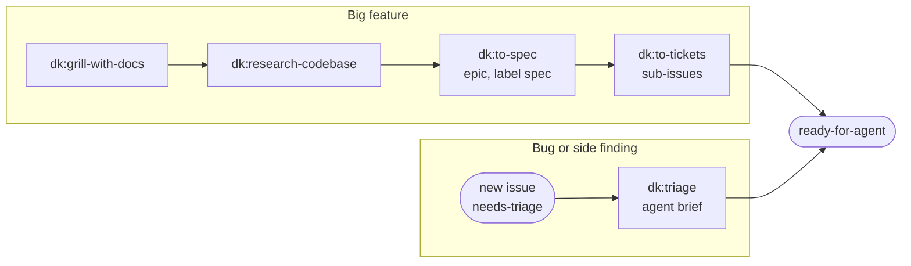
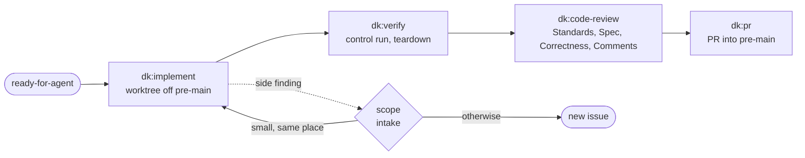
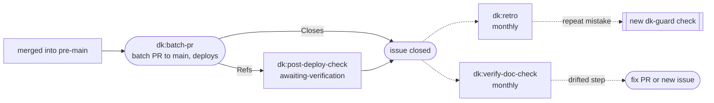
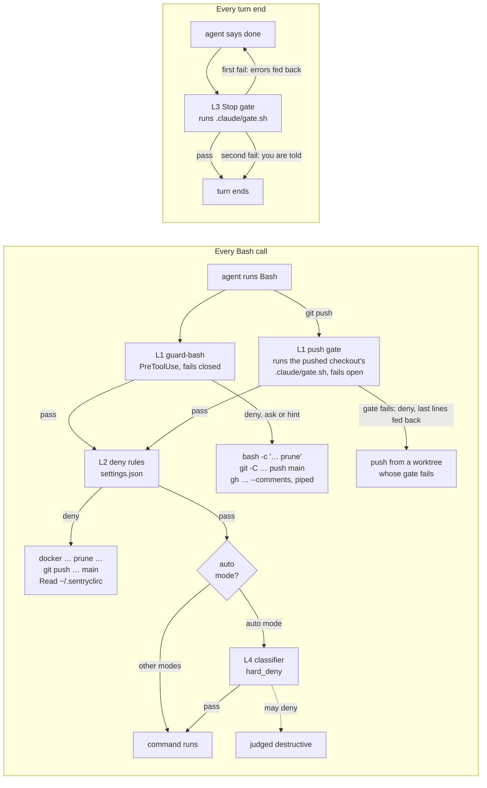

# dk-agent-kit

My Claude Code setup as a plugin marketplace: guardrails that hold whether or
not the agent reads its instructions, and the skills I work with,
adapted from [mattpocock/skills](https://github.com/mattpocock/skills),
[pstack](https://github.com/cursor/plugins/tree/main/pstack) and
[HumanLayer](https://github.com/humanlayer/humanlayer).

Claude Code only for now. Codex and other hosts will follow.

## What is in it

| Path | What it does |
|---|---|
| `plugins/dk-guard` | PreToolUse hook on Bash. It **denies** `docker`/`podman prune`, mass removal without a label or name filter, pushes to `main`/`master` (explicit, `HEAD:main`, or a bare push while on main), plain force pushes (`--force-with-lease` and `verify-assets/*` are fine), `git push --mirror`, `git clean -x`, reading `~/.sentryclirc`, `~/.aws/credentials`, `~/.netrc` or a private SSH key (`ls`, `stat` or `[ -e ]` pass when their output feeds no other command, and the name in the pattern or script of `sed`, `grep`, `rg` or `awk` is text, not a read, unless the script reads files itself, as sed's `r` or awk's `getline` do; Sentry events come from the Sentry helper named in the repo's `docs/agents/observability.md`), a zsh special parameter such as `path` (tied to `PATH`), `status` or `argv` as a `for`, `read` or assigned variable, which leaves every later command "not found" (`PATH=…`, `path+=(…)` and `path=(… $path)` pass), three more zsh shapes that break a call (`$name:` before a modifier letter, as in `$c:refs`, which loses `:r`; a variable holding a command with spaces, set in the same call or as a quoted item of a `for`, `foreach` or `select` list, used as the command, which zsh does not split (`${=name}` or an array passes); a function named like one of your zsh aliases, such as `g(){ … }` when `g` is an alias, which zsh refuses to define; the names come from the list `bootstrap.sh` writes, and without it this rule denies nothing), `gh issue view --comments` without `--json`, which drops the body when piped, and `rm` inside a `dk:verify` run directory (`verify.XXXXXX`, named by its path, a variable the same call sets, a `cd` into one, or a session already there), since a rerun takes a new one and the earlier runs stay as evidence. It also **denies** a CI or merge wait in the foreground (`gh pr checks --watch`, `gh run watch`, or a loop that runs `gh pr`, `gh run` or a read-only `gh api` call, one without a write method or fields, and sleeps), which blocks the session until it returns; the same command started with `run_in_background` passes. It **asks** before rewriting or deleting `pre-main`, before a push to the current branch when it cannot tell which branch that is (`cd "$WT" && git push`), and before `dk-gc --yes` or `dk-gc` with piped input, so its one yes stays the human's. Piped `gh pr view --comments` gets a hint that the body is missing, and a Postgres server started by `docker run` (detached or without `--rm`) and without a `dk.issue` label gets a hint to use `dk-pg`, and `git worktree remove` inside a `for`, `while` or `until` loop gets a hint to use `dk-gc`. The rules match on the command's words, split once as the shell reads them (quotes, here-docs, redirections, substitutions and `bash -c` scripts included); a command it cannot split gets the raw-string checks. The hook fails closed (`onFailure: block`). `bin/dk-pg` is on the agent's PATH: `dk-pg up <issue>` starts a throwaway Postgres (`--rm`, tmpfs, labels `dk.repo`, `dk.root` and `dk.issue`) on a free port and prints its URL, `dk-pg url <issue>` reprints it, `dk-pg status <issue>` prints it or that none runs and exits 0 either way (the teardown check), `dk-pg down <issue>` removes it. `dk-gc` lists, grouped by repo, the worktrees and local and remote branches of merged PRs and the `dk-pg` databases of closed issues, then removes them after one yes (`--dry-run` only lists); it never removes `pre-main`, `verify-assets/*`, the base of any PR, a branch with an open PR, a worktree with uncommitted changes, or a worktree with ignored files outside a regenerable list (`node_modules/`, `dist/`, `build/`, `.next/`, `target/`, `.venv/`, `__pycache__/`, `*.tsbuildinfo`, `*.gen.*`, `.env*`), which its "keep" line names, since `git worktree remove` deletes ignored files without asking. `dk-assets push <issue> <file>…` pushes verify screenshots from the session's scratch directory as an orphan commit to `verify-assets/<issue>` (a rerun replaces it) and prints the commit SHA and one embeddable URL per file. A Stop hook runs the repo's executable `.claude/gate.sh` when the tree has uncommitted changes: a failing gate blocks the turn's end once and hands the agent the gate's last lines; a second failure ends the turn and tells you. It fails open. A second PreToolUse hook gates pushes: before a `git push` it runs `.claude/gate.sh` in the checkout being pushed (the `cd` or `git -C` target, so a push from a worktree runs that worktree's gate wherever the session started) and denies the push when the gate fails, with its last lines. Pushes of `verify-assets/*`, branch deletes and pushes the guard denies anyway run no gate; a push whose directory is known only at run time (`cd "$WT" && git push`) runs none either, and the agent is told so. A gate still running after 540 s is killed and the push goes through with a message to you; the hook fails open. |
| `plugins/dk` | The skills, called as `/dk:<name>`. You start: `triage`, `implement`, `implement-spec`, `batch-pr`, `to-spec`, `to-tickets`, `research-codebase`, `grill-with-docs`, `improve-codebase-architecture`, `teach`, `prototype`, `retro`, `verify-doc-check`, `handoff`, `setup`. Other skills call: `issue-flow`, `verify`, `post-deploy-check`, `tdd`, `code-review`, `pr`, `blast-radius`, `research`, `grilling`, `domain-modeling`, `codebase-design`, `writing-for-agents`. Agents: the read-only reviewers `reviewer` and `comment-reviewer`, and HumanLayer's `codebase-locator`, `codebase-analyzer`, `codebase-pattern-finder`. Each repo supplies its facts in adapter files that `/dk:setup` writes. |
| `upstream/` | `UPSTREAM.md` records the commit and changes for every adapted file; `sync.sh` shows what mattpocock/skills, pstack and HumanLayer changed since in those files. |
| `settings/user.fragment.json` | What a plugin cannot ship: permission allow (the sanctioned pushes), deny and ask rules, and `autoMode.hard_deny` lines. Merged into `~/.claude/settings.json` by `bootstrap.sh`. |
| `bootstrap.sh` | Shows the settings diff, the zsh options block for `~/.zshenv`, the zsh alias-name list for `dk-guard` and the `--isolated` change to the `playwright` MCP server; `--apply` backs both files up, writes them and the list, installs the plugins from this checkout and re-registers the server. |
| `tests/` | The guard's case matrix (taken from real incidents), fixture repos for the Stop gate, the push gate and the session hooks, a `dk-pg` run against Docker, a `dk-gc` run against fixture repos with stubbed `gh` and `docker`, a `dk-assets` run against a local origin, a bootstrap test with a stubbed `claude` and `zsh`, an `upstream/sync.sh` run against fixture upstream repos, a check of the skill-eval fixtures, a run of the `dk:retro` extraction script against fixture transcripts, runs of the `dk:batch-pr` collection and review scripts against a fixture repo with the stubbed `gh` and `coderabbit`, a run of `dk:issue-flow`'s review-bot wait against a stubbed `gh`, and `replay_history.py` for checking the guard against past transcripts. |
| `THIRD_PARTY/` | Licenses and commits of the projects material is adapted from. |

Every rule traces back to something that went wrong in a real session: a
triage agent ran `docker container prune -f` and deleted other projects'
containers; prototype work in ignored `docs/*` was lost; an agent scraped a
token out of `~/.sentryclirc`. Rules in prose did not prevent these, so they
live in a hook now. The hook raises the floor against mistakes; it is not a
security boundary.

## Workflow

Every issue reaches `ready-for-agent` by one of two paths, then follows the
same line to deploy.



`dk:research-codebase` reads the ticket and turns it into neutral questions;
the documentarian subagent that answers them never sees the ticket or the
conversation, so it describes the code as it is rather than arguing for a
solution.





The scope intake decides what a side finding becomes: small work in the same
place joins the issue as a recorded scope amendment, anything else is a new
issue. An issue with a `Refs` line stays open until its post-deploy check
passes.

Two runs come back every month, started by hand in each repo: `/dk:retro`
over the month's sessions turns each repeated mistake into a check, and
`/dk:verify-doc-check` runs the repo's `docs/agents/verify.md` in a fresh
worktree and fixes or files every step that no longer works.

### Where a command gets stopped



The hooks run before the permission rules, and nothing they return overrides
a matching deny rule. L1 (guard and push gate), L2 and the L3 Stop gate are
deterministic and ship here. L4 runs only in auto mode, is a judgement call, and is only a
backstop. CI is the next layer, outside the session, and skill
text and `AGENTS.md` the last.

## Session hooks

`dk-guard` also opens every session with a baseline of at most 15 lines:
repo and branch, primary checkout or worktree, uncommitted changes, the open
PR for the branch, the labels of the issue the branch names
(`<type>/<issue>-<slug>`), the `dk-pg` databases running for it and, from 5
linked worktrees on, their count with a pointer to `dk-gc --dry-run` (counted
with git alone, since a dry run asks GitHub about every branch). It is silent
outside a git repo.

A repo can require worktrees with one committed setting in its
`.claude/settings.json`:

```json
{ "env": { "DK_REQUIRE_WORKTREE": "1" } }
```

An Edit or Write to a file in that repo's primary checkout is then denied
with the worktree command from its `docs/agents/workflow.md`; the same edit in
a linked worktree goes through. Several sessions share a primary checkout and
only the branch pointer moves, which is where parallel sessions collided.
Both hooks fail open: a crash never blocks an edit.

## Install

```sh
git clone https://github.com/kaminski-dev/dk-agent-kit ~/workspace/dk-agent-kit
cd ~/workspace/dk-agent-kit
./bootstrap.sh            # read the diff
./bootstrap.sh --apply    # write it, add the marketplace, install dk-guard and dk
```

The marketplace is added from the local path, and its relative plugin
sources load straight from this checkout: after `git pull`, `/reload-plugins`
or a restart applies the changes, with no version bump and no
`claude plugin update`. Client-specific settings
(`autoMode.environment`, for example) go in `~/.config/dk-agent-kit/private.json`;
bootstrap merges that file last, and it never enters this repo.

Merge rules: objects merge key by key, arrays gain the entries they lack and
nothing is removed, scalars from the fragment win. A second run is a no-op.

The Bash tool runs zsh, and agents write bash. Bootstrap appends a marked
block to `~/.zshenv` (`$ZDOTDIR/.zshenv` when set) with `setopt NO_NOMATCH`
(an unmatched glob such as `--include=*.go` passes through literally) and
`unsetopt EQUALS` (`echo ====` is not expanded to a command path). The rest
of the file stays as it is. A file that already has the marker, or sets both
options by hand, is left alone.

zsh refuses to define a function named like an alias ("defining function based
on alias"), and agents write helpers such as `g(){ … }`. Bootstrap asks an
interactive zsh for your alias names (the names only, never what they expand
to) and writes them to `~/.config/dk-agent-kit/zsh-aliases`, beside the
private overlay, where `dk-guard` reads them from `HOME` alone; it denies a
function with one of those names. Rerun bootstrap after changing your aliases.

Two sessions started from one directory share the Playwright MCP browser
profile, and the second gets "Browser is already in use". When a user-scope
`playwright` MCP server runs without `--isolated` (in-memory profile),
bootstrap shows the args it would change, and `--apply` re-registers the
server through the CLI (`claude mcp remove`, then `claude mcp add-json` with
the same command, args and environment plus `--isolated`), keeping the old
definition in a private `playwright-mcp.json.bak-*` next to the settings file;
environment values are never printed. Sessions started afterwards pick it up. A server that already has the flag, or a project- or
local-scope one, is left alone, and bootstrap never adds one that isn't there.

## Test

```sh
python3 -I tests/hooks/test_guard_bash.py
python3 -I tests/hooks/test_stop_gate.py
python3 -I tests/hooks/test_push_gate.py
python3 -I tests/hooks/test_require_worktree.py
python3 -I tests/hooks/test_session_baseline.py
python3 -I tests/test_skills.py
python3 -I tests/test_evals.py
python3 -I tests/test_retro_extract.py
python3 -I tests/test_wait_review.py
python3 -I tests/test_batch_pr.py
bash tests/test_bootstrap.sh
bash tests/test_dk_pg.sh      # skips without a Docker daemon
bash tests/test_dk_gc.sh
bash tests/test_dk_assets.sh
bash tests/test_sync.sh
claude plugin validate .
```

The evals for `dk:implement`, `dk:triage`, `dk:code-review` (a report on all four axes, with
seeded Standards and Correctness defects) and `dk:verify` live in
`plugins/dk/evals/` and need a model, so they run by hand (the command is in
`docs/agents/workflow.md`), not in CI.

`replay_history.py <commands.jsonl>` runs every past Bash command through the
guard and lists what it would deny, ask or hint, so a new rule can be checked
for false positives before it ships.

## Adding a rule

A repeated mistake becomes a check, not another paragraph: add a case to
`tests/hooks/guard_bash_cases.json` that reproduces it, see it fail, change the
guard, and replay the history to see what else the rule catches.
