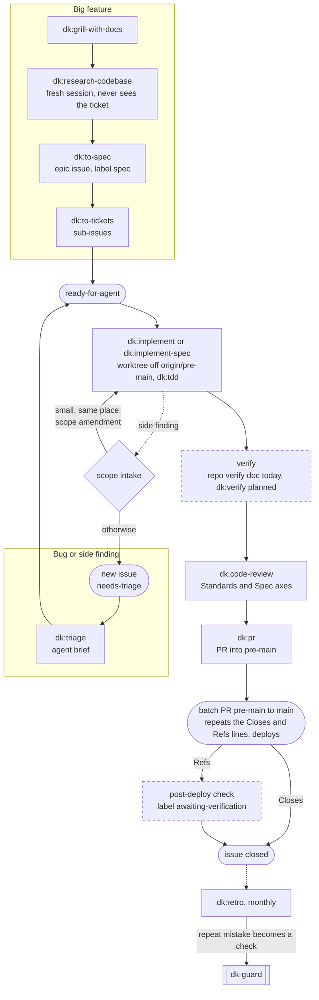
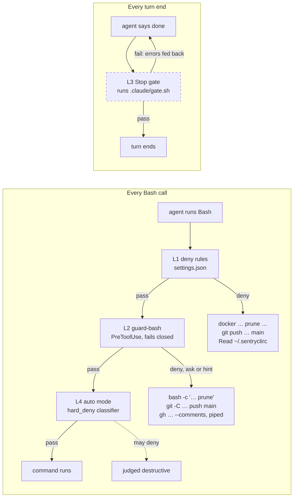

# dk-agent-kit

My Claude Code setup as a plugin marketplace: guardrails that hold whether or
not the agent reads its instructions, and the skills I work with,
adapted from [mattpocock/skills](https://github.com/mattpocock/skills),
[pstack](https://github.com/cursor/plugins/tree/main/pstack) and
[HumanLayer](https://github.com/humanlayer/humanlayer).

Claude Code only for now. Codex and other hosts will follow.

## What is in it

| Path | What it does |
|---|---|
| `plugins/dk-guard` | PreToolUse hook on Bash. It **denies** `docker`/`podman prune`, mass removal without a label or name filter, pushes to `main`/`master` (explicit, `HEAD:main`, or a bare push while on main), plain force pushes (`--force-with-lease` and `verify-assets/*` are fine), `git push --mirror` and `git clean -x`. It **asks** before rewriting or deleting `pre-main` and before reading `~/.sentryclirc`, `~/.aws/credentials`, `~/.netrc` or a private SSH key. Piped `gh issue view --comments` gets a hint that the body is missing. The hook fails closed (`onFailure: block`). |
| `plugins/dk` | The skills, called as `/dk:<name>`. You start: `triage`, `implement`, `implement-spec`, `to-spec`, `to-tickets`, `research-codebase`, `grill-with-docs`, `improve-codebase-architecture`, `teach`, `prototype`, `retro`, `handoff`, `setup`. Other skills call: `issue-flow`, `tdd`, `code-review`, `pr`, `blast-radius`, `research`, `grilling`, `domain-modeling`, `codebase-design`, `writing-for-agents`. Agents: `reviewer` (read-only) and HumanLayer's `codebase-locator`, `codebase-analyzer`, `codebase-pattern-finder`. Each repo supplies its facts in adapter files that `/dk:setup` writes. |
| `upstream/` | `UPSTREAM.md` records the commit and changes for every adapted file; `sync.sh` shows what mattpocock/skills changed since (pstack and HumanLayer are compared by hand). |
| `settings/user.fragment.json` | What a plugin cannot ship: permission deny and ask rules, and `autoMode.hard_deny` lines. Merged into `~/.claude/settings.json` by `bootstrap.sh`. |
| `bootstrap.sh` | Shows the settings diff; `--apply` backs up, merges and installs the plugins from this checkout. |
| `tests/` | The guard's case matrix (taken from real incidents), a bootstrap merge test, and `replay_history.py` for checking the guard against past transcripts. |
| `THIRD_PARTY/` | Licenses and commits of the projects material is adapted from. |

Every rule traces back to something that went wrong in a real session: a
triage agent ran `docker container prune -f` and deleted other projects'
containers; prototype work in ignored `docs/*` was lost; an agent scraped a
token out of `~/.sentryclirc`. Rules in prose did not prevent these, so they
live in a hook now. The hook raises the floor against mistakes; it is not a
security boundary.

## Workflow

Every issue reaches `ready-for-agent` by one of two paths, then follows the
same line to deploy. Dashed boxes are planned and not built yet.



The scope intake decides what a side finding becomes: small work in the same
place joins the issue as a recorded scope amendment, anything else is a new
issue. An issue with a `Refs` line stays open until its post-deploy check
passes.

### Where a command gets stopped



L1 and L2 are deterministic and ship here, and the L3 Stop gate will join
them; L4 is a judgement call and only a backstop. Outside the session, repo lint and CI are the next layer, and skill
text and `AGENTS.md` the last.

## Install

```sh
git clone https://github.com/kaminski-dev/dk-agent-kit ~/workspace/dk-agent-kit
cd ~/workspace/dk-agent-kit
./bootstrap.sh            # read the diff
./bootstrap.sh --apply    # write it, add the marketplace, install dk-guard and dk
```

The marketplace is added from the local path, and its relative plugin
sources load straight from this checkout: after `git pull`, `/reload-plugins`
or a restart applies the changes, with no version bump and no
`claude plugin update`. Client-specific settings
(`autoMode.environment`, for example) go in `~/.config/dk-agent-kit/private.json`;
bootstrap merges that file last, and it never enters this repo.

Merge rules: objects merge key by key, arrays gain the entries they lack and
nothing is removed, scalars from the fragment win. A second run is a no-op.

## Test

```sh
python3 -I tests/hooks/test_guard_bash.py
python3 -I tests/test_skills.py
bash tests/test_bootstrap.sh
claude plugin validate .
```

`replay_history.py <commands.jsonl>` runs every past Bash command through the
guard and lists what it would deny, ask or hint, so a new rule can be checked
for false positives before it ships.

## Adding a rule

A repeated mistake becomes a check, not another paragraph: add a case to
`tests/hooks/guard_bash_cases.json` that reproduces it, see it fail, change the
guard, and replay the history to see what else the rule catches.
